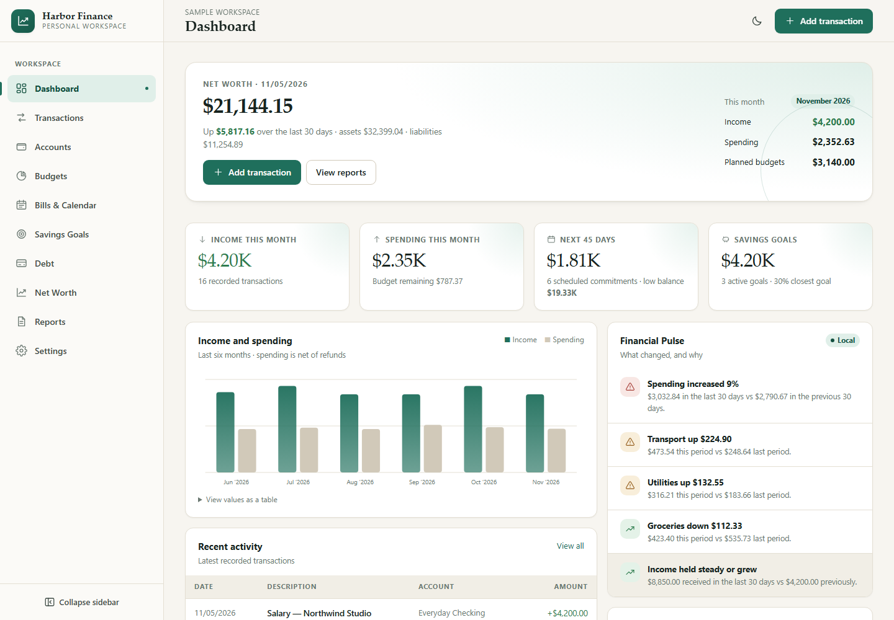

# Obsidian Finance — Ultimate Personal Finance Tracker

A private, offline-first personal finance workspace for accounts, transactions, budgets, bills, goals, debt and net worth. Built with React, TypeScript and IndexedDB. No bank connection, no account, no cloud, no subscription.



## Why this exists

Most finance apps want your bank credentials and a monthly fee. Obsidian Finance is the opposite: a complete local workspace you own. Your records stay in your browser, export to a versioned JSON file, and never leave the device.

It is a real application — not a spreadsheet template — with validated forms, safe history, detail routes, keyboard navigation, accessible charts and a tested calculation layer.

## Features

- **Accounts:** checking, savings, cash, investment, credit, loan and other, with signed balances and clear liability handling.
- **Transactions:** income, expense and transfers; categories with one level of nesting; payees, notes, tags and fast entry.
- **Budgets:** monthly or custom periods, per-category allocations, refund-aware spending and visible unallocated spending.
- **Bills and calendar:** recurring income and expenses, paid/skipped tracking, rescheduling, amount overrides and overdue detection.
- **Goals:** savings goals and sinking funds with contributions, withdrawals and required monthly amounts.
- **Debt:** snowball, avalanche and custom payoff estimates with interest totals and a debt-free date.
- **Net worth:** monthly history, 30-day change, asset and liability breakdown.
- **Reports:** income, net spending, category shares, budget performance, largest expenses and CSV export.
- **Import:** CSV preview with duplicate detection, date normalisation and atomic batch writes.
- **Backups:** versioned JSON with checksum, schema and relationship validation, single-transaction restore and wipe.
- **PWA:** installable, offline-capable app shell with generated icons.
- **Accessibility:** keyboard dialogs, labelled inputs, announced errors, chart data tables and reduced-motion support.

Nothing is automated behind your back: there is no bank sync, no telemetry and no AI advice.

## Tech stack

| Area    | Choice                               |
| ------- | ------------------------------------ |
| UI      | React 19, TypeScript, React Router 7 |
| Build   | Vite 7                               |
| Styling | CSS variables, layered stylesheets   |
| Data    | Dexie 4 / IndexedDB, Zod validation  |
| Tests   | Vitest, Testing Library, Playwright  |
| Offline | vite-plugin-pwa / Workbox            |
| CI      | GitHub Actions                       |

## Quick start

Requirements: Node.js 20.19+ (22 LTS recommended) and npm 10+.

```bash
npm ci
npm run dev
```

Open the printed local URL. Choose **Explore sample workspace** to see a populated app, then remove the sample data in **Settings** when you are ready to start your own records.

### Production build

```bash
npm run build
npm run preview
```

The build is a static site in `dist/`. Because routing uses hashes and the Vite base is relative, you can host it on GitHub Pages, Netlify, Cloudflare Pages, a subfolder or any static file server without rewrite rules.

## Scripts

| Command                | Purpose                                         |
| ---------------------- | ----------------------------------------------- |
| `npm run dev`          | Start the Vite development server               |
| `npm run build`        | Typecheck and create the production build       |
| `npm run preview`      | Serve the production build locally              |
| `npm run typecheck`    | TypeScript with no emit                         |
| `npm run lint`         | ESLint                                          |
| `npm run format`       | Write Prettier formatting                       |
| `npm run format:check` | Verify formatting                               |
| `npm test`             | Vitest unit, repository and component tests     |
| `npm run e2e`          | Playwright journeys (install Chromium first)    |
| `npm run verify`       | Format check → typecheck → lint → tests → build |

First E2E run:

```bash
npx playwright install chromium
npm run e2e
```

## Your data and backups

- Data is stored in IndexedDB under the browser origin that serves the app.
- Clearing site data, using a different browser profile or moving to a different origin starts an empty workspace.
- **Settings → Export backup** downloads a versioned JSON file containing every table and your settings.
- **Restore** validates size, JSON, app identity, version, checksum, schema, duplicate IDs and relationships before writing. A failed restore leaves the current database untouched.
- **Wipe all data** requires a fresh backup download first and runs in a single transaction.
- CSV exports are available for transactions and report summaries.
- Keep backups outside the browser, for example in an encrypted folder or password manager attachment.

## Privacy

- No analytics, error reporting, remote fonts, CDNs or third-party scripts.
- No financial data is sent over the network.
- The only network activity is loading the app assets the first time (and PWA updates).

## Project structure

```
src/
├── components/   UI primitives, forms, charts, layout
├── db/           Dexie schema, repositories, backups, sample data
├── domain/       pure financial rules and calculations
├── pages/        route screens
├── state/        live data provider and formatters
└── styles/       design tokens and stylesheets
tests/            unit, repository and component tests
e2e/              Playwright journeys
docs/             specifications, rules, guides and release notes
```

See [docs/ARCHITECTURE.md](docs/ARCHITECTURE.md) for dependency rules and data flow.

## Documentation

- [Product specification](docs/PRODUCT_SPEC.md)
- [Competitor analysis](docs/COMPETITOR_ANALYSIS.md)
- [UX specification](docs/UX_SPEC.md)
- [Architecture](docs/ARCHITECTURE.md)
- [Data model](docs/DATA_MODEL.md)
- [Financial rules](docs/FINANCIAL_RULES.md)
- [Acceptance criteria](docs/ACCEPTANCE_CRITERIA.md)
- [Architecture decisions](docs/DECISIONS.md)
- [Implementation plan](docs/IMPLEMENTATION_PLAN.md)
- [Customer guide](docs/CUSTOMER_GUIDE.md)
- [Etsy listing kit](docs/ETSY_LISTING.md)
- [AI development protocol](AI_DEVELOPMENT_PROTOCOL.md)

## Known limitations

- No bank connections or automatic transaction download.
- One workspace per browser origin; no built-in multi-user sync.
- Account currencies are informational; totals use the workspace currency.
- Budget rollover is not automatic in 1.0.
- Debt and forecast projections are estimates, not advice.
- Investment accounts track balances only; no price feeds.

## License

Sold as a digital product. The buyer may use the app for personal use and keep their own backups. Redistribution or resale of the source is not permitted. See the listing terms for the exact license.
